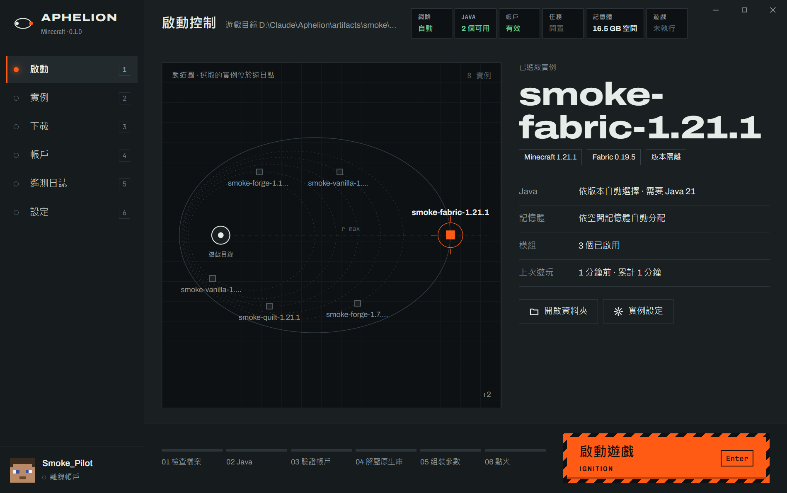

# Aphelion

A Minecraft: Java Edition launcher for Windows, built around a Mission Control console language
("NASA-punk"): graphite panels, recessed data screens, annunciator lamps that report real system state,
and a guarded ignition button. Every instance sits on an orbit map; the one you select travels to the
aphelion.



## What it does

| Area | Capabilities |
| --- | --- |
| Instances | Create vanilla, Fabric, Quilt, Forge (legacy and modern) and NeoForge instances; each is one self-contained folder. Rename, recolour, isolate, repair by hash, delete to the Recycle Bin. Reads existing `.minecraft` folders. |
| Launch | Six-stage sequence (verify files → Java → account → natives → arguments → ignition), per-version Java selection with automatic download of Mojang runtimes, automatic heap sizing, Quick Play server join, live log console, rule-based crash diagnosis. |
| Accounts | Offline, Microsoft (device-code sign-in), and authlib-injector servers (LittleSkin, Blessing Skin). Tokens are encrypted with DPAPI; passwords are never stored. |
| Content | Modrinth search and install with required dependencies, update checks by file hash, drag-and-drop install, enable/disable, `.mrpack` import and export, world list. |
| Downloads | Only from the publishers' own servers, every file hash-verified. Large files in parallel ranges with resume, connections raced across CDN edges, identical files reused from other game folders on the PC; a connection check shows how each official server performs from your network. |
| Lifecycle | Per-user install (no admin rights), in-place upgrade, uninstall that keeps data by default, explicit full cleanup. One click switches between standard and portable mode and moves the data safely. Signed in-place updates from the release page. |
| Interface | Traditional Chinese, Simplified Chinese and English; dark and light themes; a motion system with a reduced mode; works from a 900 × 600 window up. |

## Quick start

Requirements: Windows 10/11 x64, the [.NET 10 Desktop Runtime](https://dotnet.microsoft.com/download/dotnet/10.0),
and Microsoft Edge WebView2 (preinstalled on Windows 11).

Download `Aphelion.exe` from the [releases](../../releases) and run it — it is a single file. Or build it:

```powershell
pwsh ./build.ps1              # UI bundle, checks, unit tests, single-file publish
./artifacts/publish/Aphelion.exe
```

Running the file directly works immediately (data goes to `%LOCALAPPDATA%\Aphelion`).
**Settings › Data and storage** installs it for the current user (Start menu, Windows Settings › Apps) or
switches it to portable mode, where everything lives in a `Data` folder beside the program.

## Documentation

- [Architecture](docs/architecture.md) — projects, layers, the UI bridge, the motion system
- [Data, install and uninstall](docs/lifecycle.md) — where every file lives, what removes it, how mode switching moves data
- [Accounts](docs/accounts.md) — Microsoft sign-in setup, authlib-injector, token storage
- [Development](docs/development.md) — building, testing, the smoke test, what has been verified

## Status

Version 0.2.0, a private preview. Eight version/loader combinations were installed and launched for real,
and install, upgrade, uninstall and mode switching were exercised on Windows 11; see
[docs/development.md](docs/development.md#verification) for exactly what has been verified and what has not.

Minecraft is a trademark of Mojang Studios. Aphelion is not affiliated with Mojang or Microsoft.
